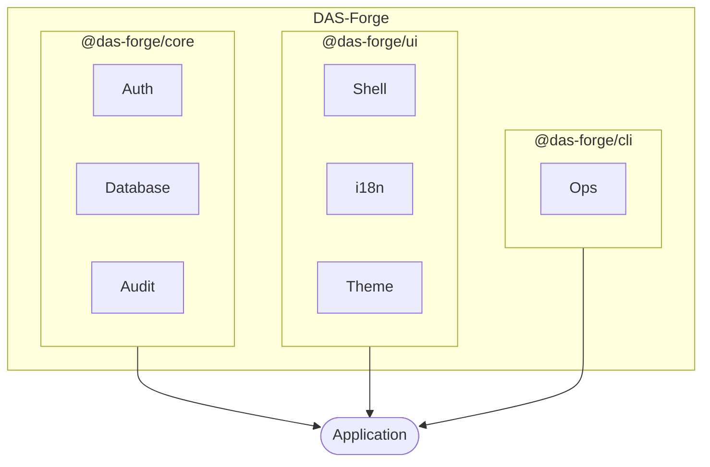

# DAS-Forge

DAS-Forge is a modular application platform for building internal web applications on a shared backend foundation — administration UI, security, database infrastructure, operational tooling, and reusable services.

It eliminates duplicated infrastructure across independent Node.js applications while keeping business logic inside each application.

## What it provides

- HTTP and application infrastructure
- Configuration and environment management
- Logging and error handling
- Validation
- Authentication and sessions
- Authorization and permissions
- SQLite database infrastructure, transactions, and migrations
- Audit logging
- Database backup and restore
- Health checks and diagnostics
- Realtime events
- Unified CLI and operational commands
- Shared administration UI

Optional packages: email, image processing, HEIC/HEIF support, LDAP integration, file storage, document generation, data exports, QR codes, network integrations.

## UI Platform

- Shared admin application shell (vanilla JS, no frontend framework)
- Responsive admin layout with light/dark themes and system detection
- Russian and English localization, extensible i18n
- Shared, permissions-aware navigation
- Dialogs, drawers, forms, validation UI, data tables
- Notifications and command palette
- User/account UI
- Reusable design tokens and components
- Branding and customization
- Realtime notification support

Applications build their own business screens on top of this shared UI infrastructure.

## Architecture

Applications own: business logic, domain models, application-specific schema and migrations, business permissions, business UI, and application-specific integrations. DAS-Forge provides the shared infrastructure without turning applications into a single monolithic framework.

## Packages

| Package | Purpose |
|---|---|
| `@das-forge/core` | Backend foundation |
| `@das-forge/ui` | Shared administration UI |
| `@das-forge/cli` | Development and operational CLI |
| `@das-forge/email` | Email delivery |
| `@das-forge/images` | Image processing and conversion |
| `@das-forge/ldap` | LDAP integration |
| `@das-forge/files` | File management |
| `@das-forge/documents` | Document generation |
| `@das-forge/exports` | Data export |
| `@das-forge/qr` | QR code generation |
| `@das-forge/network` | Network integrations |

## Design goals

- Shared infrastructure, independent applications
- Modularity over a monolithic framework
- Explicit contracts between infrastructure and applications
- Secure defaults
- Reusable UI instead of duplicated admin interfaces
- Application-owned business logic
- Configuration over hard-coded infrastructure
- Operational tooling as a first-class concern

## Technology

**Backend:** Node.js (latest LTS), Express, JavaScript / ESM, Zod, SQLite, Argon2

**Frontend:** Vanilla JavaScript admin UI (no framework), i18n

**Testing:** Playwright

## Status

DAS-Forge is an actively developed internal platform. The API and package boundaries may evolve until the first stable release.

## License

MIT License. Copyright (c) 2026
